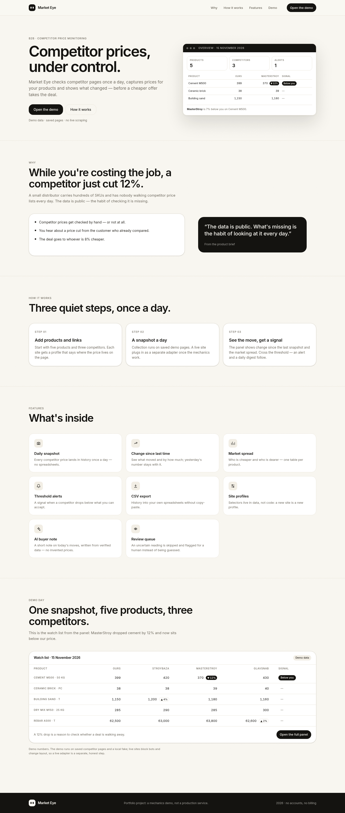
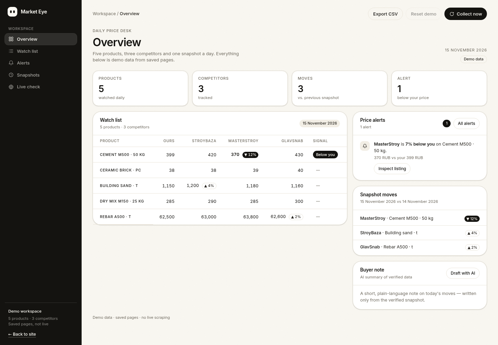
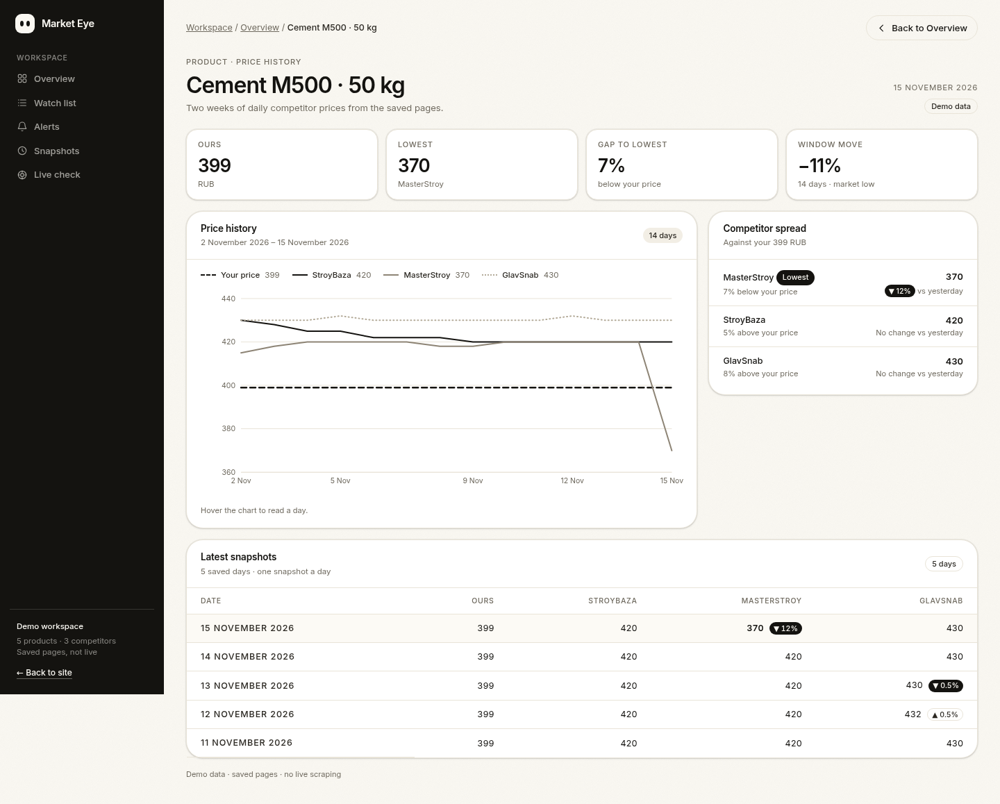
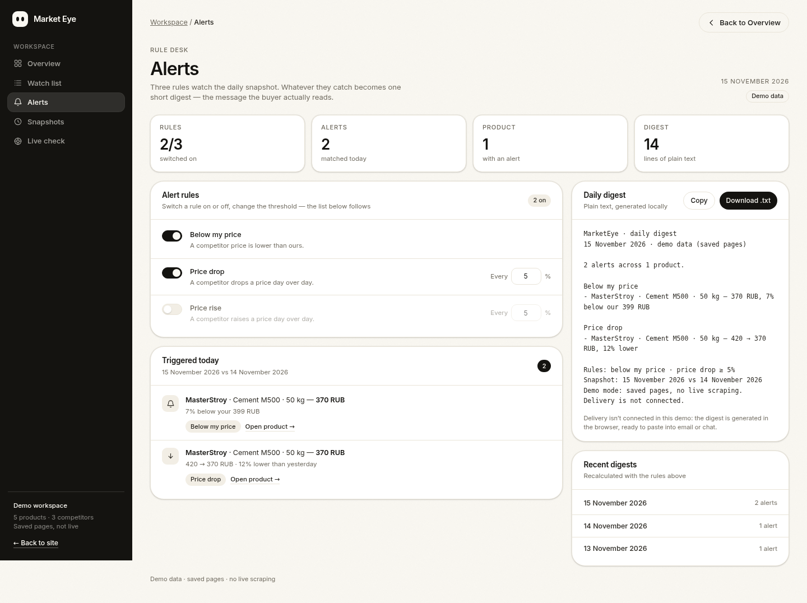
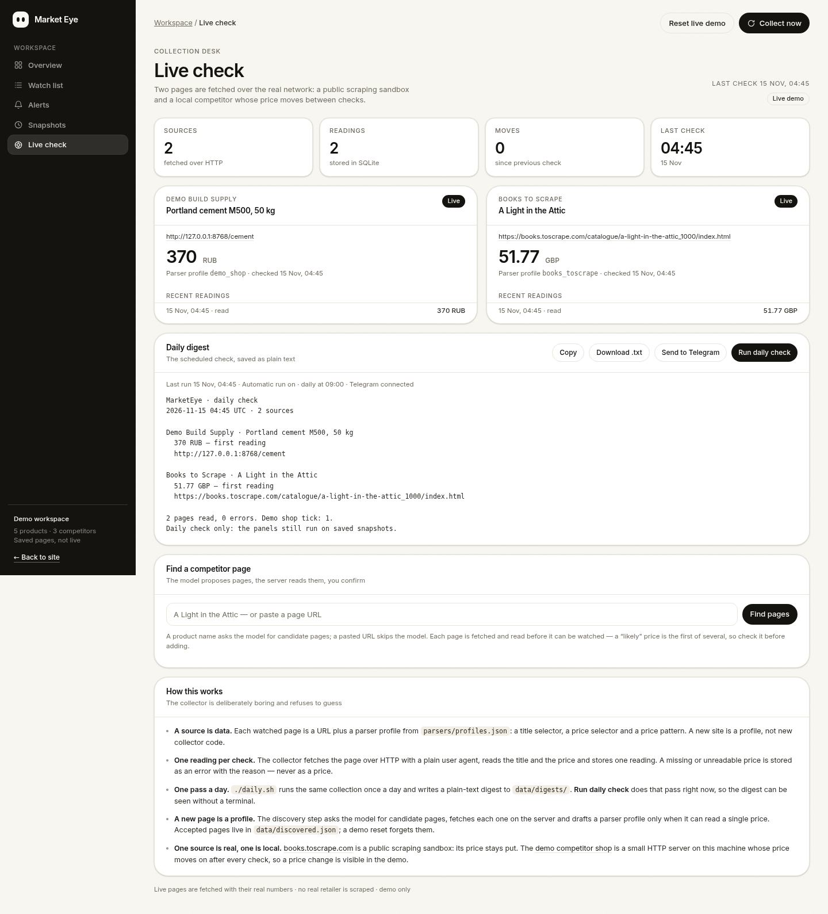
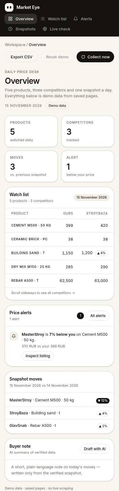

# MarketEye

**Watch what competitors do with prices — see the change before it hurts the deal.**

MarketEye is a B2B SaaS prototype for a small distributor or retailer: add the
products you sell and the pages where competitors sell the same things, and every
day the service records their prices. The dashboard shows what moved, by how much
and when; a digest and alerts tell the buyer before a deal is lost to a cheaper
competitor.

> Status: **working demo on real HTTP.** The landing page, the Overview panel, the
> product page, the Alerts screen and a live collector are built; FastAPI + SQLite
> serve the data and evaluate the rules, and the optional AI buyer note is wired to
> Groq. The live collector reads a public scraping sandbox and a local competitor
> shop over HTTP, and a daily check runs that pass on a schedule and writes a
> plain-text digest to disk and can send it to Telegram when a bot is connected.
> The price history exports to CSV from the Overview top bar. This is a portfolio
> project, not a production platform.

## Screenshots

**Landing** — the pitch, three steps and one sample price day.



| **Overview** | **Product page** |
| --- | --- |
|  |  |
| **Alerts** | **Live check** |
|  |  |

**Mobile** — the Overview shell at 390px; the watch list scrolls sideways inside its
card instead of pushing the page.



## The problem, in one paragraph

A small distributor buys and sells a few hundred SKUs. Competitors publish prices
on their websites, but nobody has time to check them every day. So the buyer
learns that "the competitor dropped prices on cement by 12%" either by accident,
from a customer, or after losing an order. The information exists in public HTML;
what is missing is a daily, comparable, alerting view of it.

## What the first version shows

- A landing page that explains the product: a problem story, three steps, feature
  list and one demo day of the future panel — all in the project's design code.
- An **Overview** demo panel: watch list with current prices, change badges since
  the previous snapshot, undercut highlights, snapshot moves, price alerts and an
  optional AI buyer note. "Collect now" simulates the next daily snapshot, "Reset
  demo" makes the show repeatable.
- A **product page** for any product in the watch list: two weeks of daily prices
  in a small line chart (hover a day to read it), the current competitor spread and
  the latest snapshots. It opens on the same day the Overview was showing.
- An **Alerts** screen: three rules with switches and editable thresholds, the
  alerts they trigger on the snapshot, and a one-message daily digest in plain text
  that can be copied or downloaded. Rules are evaluated and stored on the server;
  delivery (email or chat) is not connected yet.
- A **Live check** screen: real pages fetched over HTTP with parser profiles, one
  stored reading per check, the last move against the previous check and the honest
  error when a page cannot be read. It watches a public scraping sandbox and a
  local competitor shop whose price changes between checks.
- A **daily check**: the same collection runs once a day in a background loop
  (`./daily.sh`), writes a plain-text digest to `data/digests/YYYY-MM-DD.txt` and
  shows it on the Live check screen, ready to copy, download or send to Telegram.
- A watch list: product + competitor + URL (a seed set of 5 products × 3
  competitors for the demo).
- A daily snapshot of each page, with the price parsed and stored as history.
- A dashboard: current price, change since the previous snapshot, the price history
  chart and the market spread per product (the product page covers this for now).
- An alert when a price moves beyond a threshold, and a short daily digest —
  shown and downloadable today, delivered to email or chat later.
- CSV export of the history from the Overview top bar: one flat table (day,
  product, competitor, price, our price) for a spreadsheet.

## Design code

The interface is a quiet monochrome workspace inspired by shadcn/ui: warm paper
canvas, a near-black sidebar, white cards on 1px hairline borders with barely
visible elevation, 24px card radii and 18px controls, and compact Inter
typography. The brand mark is a small monogram — two dots in a rounded square.
There is no decorative illustration; the product data is the visual. Price moves
stay readable without colour: arrows and small pills carry the meaning. Inter is
self-hosted in `static/fonts`, and all UI is plain HTML/CSS/JS — no external CDN,
React or Tailwind.

## Demo flow

Полный сценарий показа со словами и запасными ответами — в
[`docs/demo-script.md`](docs/demo-script.md).

1. Landing page: the problem, three steps, features and one sample price day.
2. “Watch the demo” → **Overview**: five products × three competitors, current
   prices, change since the previous snapshot, spread and a live alert.
3. **Export CSV** in the Overview top bar downloads the whole history as one flat
   table (day, product, competitor, price, our price) as
   `marketeye-history-YYYY-MM-DD.csv`.
4. Click a product name or **Inspect listing** on an alert → **product page**:
   two weeks of history, the chart, the spread and the latest snapshots.
5. **Collect now** simulates the daily collection on saved pages and appends the
   next snapshot: prices move, moves and alerts update.
6. **Draft with AI** asks the model for a short buyer note based only on that
   verified snapshot (optional — needs a Groq key).
7. **Alerts** (sidebar or “All alerts”): switch rules on and off, change the
   threshold and watch the list and the digest follow; copy the digest or download
   the `.txt`.
8. **Live check** (sidebar): **Collect now** fetches the watched pages over HTTP,
   stores a reading for each and shows the move against the previous check; the
   local competitor shop moves to its next price after every check.
9. **Daily check** on the same screen: **Run daily check** fetches both pages,
   stores the readings and writes a plain-text digest; the card shows the last run,
   the automatic schedule and Copy / Download for the digest. With a bot connected,
   **Send to Telegram** delivers it to your chat.
10. **Reset demo** brings the baseline back, so the demo can be shown again. On the
    live screen it also clears the readings and the saved digests.
11. The panels state their limits honestly: demo data and saved pages for the
    panels; the live screen shows exactly which pages were fetched and when.

## AI buyer note (optional)

The Overview panel can ask Groq to write a short buyer note from the verified
snapshot. This is the only AI in the product: it explains the data, it never
fetches prices or invents numbers. The key lives server-side in `.env`
(`GROQ_API_KEY`, see `.env.example`) and never reaches the browser or git.
Without a key the button honestly says AI is not configured and the rest of the
demo works unchanged. The free Groq tier is enough for a portfolio demo; by
default it uses `openai/gpt-oss-20b` (another model id can be set in `.env`).

## Telegram delivery (optional)

The daily digest can go to Telegram with no paid service. Talk to **@BotFather**,
create a bot, copy its token into `.env` as `TELEGRAM_BOT_TOKEN`; press **Start**
in the bot and run

```bash
.venv/bin/python -c "import telegram; print(telegram.discover_chat_id())"
```

to get your `TELEGRAM_CHAT_ID` (the id never has to be typed by hand). Both values
stay server-side; the browser never sees them. When configured, the daily check
sends the digest automatically and the Live check card gets a **Send to Telegram**
button; when not configured, delivery is off and the rest of the demo works
unchanged. It is one message to one chat: no queue, no retries, no email yet.
`./daily.sh telegram` shows whether delivery is configured, `./daily.sh send`
sends the latest digest from the console.

## How it works

```text
watch list (product, competitor, url)
        │
        ▼
   collector ── HTTP adapter (live sites) / snapshot adapter (demo)
        │
        ▼
   parser profiles ── per-site selectors, kept as data, not code branches
        │
        ▼
   SQLite history ──► dashboard (FastAPI + plain HTML/JS) ──► alerts / digest
```

Today the SQLite database is rebuilt from `static/demo.json` on every start, and
FastAPI serves the panels, the API and the AI note. The panels load their data over
the API (with the same JSON as an offline fallback), and the alerts screen goes
further: rules are saved with `PUT /api/alerts/rules`, while
`POST /api/alerts/evaluate` returns the matches, stats and the digest. The browser
only renders what the server decided.

The live part is real but small on purpose. `POST /api/live/collect` fetches each
watched URL over HTTP with a plain user agent, reads the title and the price with
the parser profile, and stores one reading in SQLite. A page that cannot be
reached, or whose price does not match the profile, is stored as an error with the
reason — the collector never guesses a price. Readings are not demo fixtures, so
the seed leaves them alone and a restart keeps what was actually collected.

The daily check closes the loop between "the pages are watched" and "the buyer
reads a digest". `./daily.sh` keeps a small loop alive: once a day (09:00 local by
default, override with `MARKETEYE_DAILY_AT`) it runs one pass — fetch every live
source over HTTP, store the reading, advance the demo shop — and writes the digest
to `data/digests/YYYY-MM-DD.txt` while printing it to the log. The Live check
screen shows the latest digest and can run the same pass on demand with **Run daily
check**, so the demo does not need a terminal. `./dev.sh start` starts the
scheduler with the app; `./daily.sh run|start|stop|status|show|send|telegram|log`
manages it directly. `GET /api/daily` returns the latest digest and the scheduler state,
`POST /api/daily/run` runs one pass for the browser. The CSV export is one more
GET: `/api/export/history.csv` builds the flat table from SQLite, and the Overview
top bar is a plain download link to it.

What is still missing is the risky, boring part: adapters for sites that block
bots or change layouts, consent and robots handling, and real alert delivery
(email or chat). Adding a real site stays a parser profile plus one line in
`live_sources.json` — the same "profile is data" approach as the first portfolio
project.

## Run it

Python 3.12 + FastAPI + SQLite. The virtualenv is local and gitignored.

```bash
python3 -m venv .venv
.venv/bin/pip install -r requirements.txt
./dev.sh start     # http://127.0.0.1:8767/ · /overview · /product?id=cement · /alerts · /live
./tunnel.sh start  # optional: publish inside the owner's private Tailscale network

./daily.sh run     # one daily check now: digest printed and saved
./daily.sh start   # scheduler: one check a day at 09:00 (MARKETEYE_DAILY_AT overrides)
./daily.sh status  # is the scheduler running?
./daily.sh show    # print the latest saved digest
```

The SQLite database (`data/marketeye.db`, gitignored) is rebuilt from the fixtures
on start, so the demo is deterministic and a broken database is fixed by a restart.
Live readings are kept across restarts; **Reset live demo** clears them and the
saved digests. `data/digests/` is gitignored too: digests are runtime artifacts,
not demo fixtures.

The app also starts the local competitor shop on **127.0.0.1:8768** and proxies a
readable copy at `/demo-shop`; the collector watches it over HTTP like any other
site. Watched URLs live in `live_sources.json` and a new site is a parser profile
in `parsers/profiles.json`.

`./dev.sh start` starts the daily scheduler next to the web app, so a fresh demo
has both `http://127.0.0.1:8767/` and one automatic check a day. `./dev.sh stop`
stops both. Use `MARKETEYE_DAILY_AT=07:30 ./daily.sh start` for a different local
time; the scheduler checks every 30 seconds whether its time has come.

For the optional AI note, copy `.env.example` to `.env` and add a free Groq key.
The file is gitignored; the demo works without it.

DocFlow keeps port 8765; MarketEye uses **8767**.

## Live demo (tailnet only)

For the demo the site is also published inside the owner's **private Tailscale
network**, served by a separate userspace tailnet node that runs from `.run/ts`
(gitignored, fetched once with `./tunnel.sh setup`) and proxies port 443 to the
local dev server. The exact tailnet address is intentionally not part of this
public repository. Funnel is not enabled: the public internet cannot reach the
demo, and the host's other tailnet nodes are untouched.

## Status and limits

- Landing page, the Overview demo panel, the product page and the Alerts screen are
  implemented and checked at desktop, tablet and mobile widths.
- FastAPI + SQLite backend implemented: the database is rebuilt from
  `static/demo.json` on start and served as `/api/bootstrap`; the panels load it
  over the API. The AI note stays server-side in `app.py`.
- Alert rules are evaluated and stored on the server (`alerts.py`); the browser only
  renders the result. Saved switches and thresholds survive a page reload and reset
  when the demo database is rebuilt on restart.
- Live collection is implemented for two honest sources: `books.toscrape.com` (a
  public scraping sandbox whose price does not move) and a local competitor shop
  served by the app on port 8768 (its price changes after every check). No real
  retailer is scraped.
- The daily check is real but small: `daily.py` runs one collection pass, stores
  the readings and writes `data/digests/YYYY-MM-DD.txt`; `./daily.sh` keeps the
  loop alive (once a day at 09:00 local by default), `./dev.sh start` starts it
  with the app, and the Live check screen can run the same pass on demand. There
  are no retries or catch-up runs after downtime: a missed day stays missed.
- CSV export is implemented as a plain GET: `/api/export/history.csv` builds the
  table from SQLite and the Overview top bar downloads it as
  `marketeye-history-YYYY-MM-DD.csv`. No accounts or background jobs involved.
- Delivery is optional Telegram only: one message to one chat, no queue, no
  retries, no email channel. Without `TELEGRAM_BOT_TOKEN`/`TELEGRAM_CHAT_ID` the
  product works unchanged and the button stays off; the digest is still saved on
  disk and downloadable as a `.txt`.
- Deterministic tests (59) cover the fixtures, the SQLite round trip, the rule
  evaluation, the parser profiles (against a saved real page), the collector, the
  daily check (digest text, saved files, schedule, an injected pass), the CSV
  export and Telegram delivery (against a local mock server, never the network):
  `.venv/bin/python -m unittest discover -s tests -v`.
- Interface copy is in English (the product's language); this README is in
  Russian for the owner.
- Saved snapshots still drive the panels; the live collector is a small separate
  proof on two honest sources, and a real site is added one parser profile at a
  time.
- No accounts, roles or billing; one workspace, one user.
- The demo is a portfolio demonstration, not a claim of production readiness.

## Repository layout

```text
dev.sh             start / stop / status for the local demo (port 8767) + scheduler
daily.sh           run now / start / stop / status for the daily check
app.py            FastAPI app: pages, /api/bootstrap, product history, alerts,
                   live collection, daily digest, CSV export, AI note
daily.py           the daily pass: collect, store, digest text/file, scheduler loop
storage.py         SQLite schema, demo seeding, rules, live readings, queries
alerts.py          rule normalisation, matches, digest (server-side only)
collector.py       HTTP fetch + parser profile, one reading per source
page_parser.py     selector/price extraction; refuses to guess
demo_shop.py       local "competitor shop" HTTP server with a moving price
export.py          flat CSV export of the price history
parsers/           per-site parser profiles as data (profiles.json)
live_sources.json  watched URLs with their parser profiles
ai_note.py         optional Groq buyer note (server-side only)
requirements.txt   pinned FastAPI + uvicorn
templates/         landing, Overview, product, Alerts and Live check markup
static/            UI theme, styles/logic for the panels, Inter, demo data
static/demo.json   canonical demo fixtures (seeded into SQLite, offline fallback)
docs/              demo script (demo-script.md) and screenshots (docs/screenshots/)
telegram.py        optional Telegram delivery of the digest (server-side only)
tests/             deterministic tests: fixtures, rules, parser, collector, daily,
                   export, telegram
```
